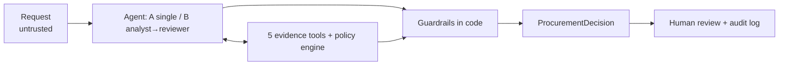

# AI Procurement Request Copilot

An internal tool for reviewing software and service purchase requests. It gathers evidence with tools (requester, budget, existing software, vendor registry, external vendor-risk service), applies the procurement policy deterministically in code, and uses Claude to interpret the request and recommend the **next action**. Every decision stays with a human.

Two architectures were built and evaluated on the same 22-case test set: **A, a single agent**, and **B, a staged analyst → reviewer pair**. **Decision: ship A.** The evidence is in [Evaluation results](#evaluation-results) and in the [decision memo](docs/decision_memo.md).

> All data is synthetic (FDE Assessment 3 starter pack).

---

## Quick start

Requires Python 3.11+.

```bash
./start.sh            # creates .venv, installs deps, runs pre-flight, starts API + UI
```

Or step by step:

```bash
python -m venv .venv && source .venv/bin/activate
pip install -r requirements.txt
cp .env.example .env          # add ANTHROPIC_API_KEY (optional; see below)
python verify_setup.py        # pre-flight
python run_local.py           # vendor-risk API :8001 + UI http://127.0.0.1:8501
```

Without `ANTHROPIC_API_KEY`, the app still works in a labelled deterministic **rules-only** mode. Each decision then carries the flag `ai_assist_unavailable`.

| Command | What it does |
|---|---|
| `python -m pytest -q` | 60 unit/integration tests: policy engine, tools, guardrails, scripted agent loop, UI smoke test. No API key needed |
| `python evals/run_public_evals.py --architecture single` / `staged` | Starter public harness (6 cases) |
| `python evals/run_comparison.py` | Full comparison: 22 cases × {single, staged} × 3 repeats + rules baseline → `evals/results/` |
| `python evals/run_comparison.py --architectures rules` | Free, deterministic run of the same test set |

The adapter required by the brief is `src/solution.py::handle_request(request_id, architecture)` (`"single"` or `"staged"`). It returns a `ProcurementDecision`.

## Product workflow

1. **Request**: pick an existing request or fill in the *New request* form. The free text is shown verbatim and labelled untrusted.
2. **Run analysis** with architecture A, B or rules-only.
3. **Recommendation panel**: the category banner, the next step, required approvals (named approver, reason and policy section for each), risk flags with reasons, and missing information.
4. **Evidence panel**: each finding with its source tool and ledger ID. Tabs show the full tool trace (inputs/outputs, caller, latency), the policy-engine output, the raw agent output before guardrails, and any guardrail interventions.
5. **Human review**: the reviewer records *accept and route*, *return for information*, *reject* or *override* (rejections and overrides require a justification). Decisions go to an append-only audit log (`var/audit_log.jsonl`). The copilot never approves, purchases or edits budgets.

Recommendation categories, in routing priority: `request_more_information` › `escalate_manual_review` › `budget_exception_review` › `route_for_specialist_review` › `redirect_to_existing_tool` › `route_for_approval`.

## Architecture

The full write-up with diagrams is in [docs/architecture.md](docs/architecture.md).



**Design principle:** AI interprets and recommends, code enforces thresholds and checks, humans make sensitive decisions.

| AI (Claude) | Code (deterministic) | Human |
|---|---|---|
| Understand the need; judge whether an existing tool already covers it; spot subtle injection and vague justifications; write the recommendation and next step | Required fields, budget arithmetic, approval tiers, Security/Privacy/Legal triggers, 365-day review validity, registry-vs-API conflicts, injection regex, routing priority, grounding checks | Approve spend, run Security/Privacy/Legal reviews, budget exceptions, overrides |

### Tools (6; 5 deterministic + 1 external API)

| Tool | Type | Source |
|---|---|---|
| `get_requester_profile` | deterministic | employees.csv (manager + department head via reporting line) |
| `check_department_budget` | deterministic | department_budgets.csv |
| `search_existing_software` | deterministic | software_catalog.csv + purchase_history.csv |
| `get_vendor_registry_record` | deterministic | vendors.csv |
| `get_vendor_risk_assessment` | external API | mock vendor-risk service (timeout, retry, typed failure) |
| `evaluate_policy_rules` | deterministic engine | `src/policy_engine.py` |

### Agents

- **A, single agent** (`src/agents/architectures.py::run_single_agent`): one Claude agent with all six tools. It typically makes three calls: parallel evidence calls, then the policy engine, then a strict-schema `submit_recommendation`.
- **B, staged** (`run_staged`): the *Procurement Analyst* (five evidence tools) submits an evidence pack. Code then runs the policy engine. The *Policy/Risk Reviewer* (no data tools) checks the pack against the full tool results and submits the same schema.

Both architectures go through the **same guardrail assembler** (`src/assembler.py`). Engine approvals and flags cannot be removed. Routing can only become more cautious, except for a judged redirect to an existing tool. Citations must resolve to ledger IDs, and numbers in a finding must appear in the cited tool output. Evidence the agent skipped is back-filled. Text claiming an approval or purchase is replaced. `human_review_required` is always true. If the LLM fails (API error, refusal, truncation, no submission), the run falls back to the deterministic decision.

### Layout

```text
app.py                  Streamlit reviewer UI
run_local.py / start.sh One-command start (mock API + UI)
src/
  solution.py           handle_request adapter (eval contract)
  copilot.py            orchestration, evidence back-fill, LLM fallback, telemetry
  tools.py              6 tools + evidence ledger
  policy_engine.py      deterministic policy (§1-§11)
  assembler.py          guardrails -> ProcurementDecision
  agents/               prompts, strict output schemas, tool loop, A and B
  llm.py                Anthropic client wrapper + usage accounting
  vendor_client.py      typed vendor-risk client
  data_access.py        typed CSV/JSON loader with scenario overrides
  mock_server.py        auto-start for the mock API
  audit.py              human decision log
evals/
  test_set.json         22 shared cases with expected outcomes
  run_comparison.py     A vs B vs rules runner + scorer
  run_public_evals.py   starter public harness (patched)
  results/              committed results (summary.md, CSV, full traces)
docs/
  architecture.md       diagrams, tools, hand-offs, assumptions
  decision_memo.md      architecture decision (<= 500 words)
  starter_pack_fixes.md issues found in the scaffold and how they were fixed
tests/                  pytest suite
```

## Assumptions

See [docs/architecture.md#assumptions](docs/architecture.md#assumptions). The main ones:

- Request amounts are annual. The approval tiers follow §4 exactly ($1,000 → Manager; $1,000.01 → Department Head + Procurement; and so on).
- **Department Head** is the nearest Director/VP in the requester's reporting line.
- The new-vendor Legal rule applies at **≥ $10,000**.
- A security review is valid for 365 days from its review date, measured at the policy reference date **2026-09-30** (read from the policy file, never the system clock).
- Overlap with a catalog product is always surfaced as a flag. Whether it blocks the purchase is the AI's judgment.
- Integrations imply data classes (CRM → customer PII, Git → source code, production/cloud → production access). A stated class lower than the implied one is flagged as a mismatch.
- "No record" at the risk service means the assessment is missing. Only a failed call counts as `vendor_risk_unavailable`.

## Evaluation results

Test set (`evals/test_set.json`, 22 cases): the **6 public cases**, the **4 other dataset requests**, and **12 synthetic edge cases** covering approval-threshold boundaries ($1,000 / $1,000.01 / >$25k), a new vendor at exactly $10k, injection in vendor-registry notes, injection with no trigger words, a full vendor-risk outage, an unknown vendor and an unknown requester, a vague request, a data-class mismatch, and an exact duplicate. Expected outcomes were derived by hand from the policy before the LLM runs. Each LLM architecture ran **3 times per case** (132 LLM runs). The rules-only baseline is deterministic and ran once.

| Metric | A · Single agent | B · Staged | Rules only |
|---|---:|---:|---:|
| Runs passing all checks | **65/66 (98%)** | **66/66 (100%)** | 19/22 (86%) |
| Public cases (starter minimum checks) | 100% | 100% | 100% |
| Correct next action (model's own choice) | 100% | 100% | n/a |
| Approvals exactly right | 100% | 100% | 100% |
| Policy + deterministic rules followed | 98% | 100% | 95% |
| Escalation / human review correct | 100% | 100% | 100% |
| Evidence grounded (0 invalid citations, 0 unsupported numbers) | 100% | 100% | 100% |
| AI detected the injection itself (injection cases) | 100% | 100% | n/a |
| Avg / p95 latency | 19.5 s / 31.8 s | 27.3 s / 37.9 s | 0.03 s |
| Avg LLM calls · tool calls | 3.0 · 6.0 | 3.0 · 6.0 | 0 · 6 |
| Avg cost / request | $0.062 | $0.078 | $0 |

Full tables, per-case results and every failure: [`evals/results/summary.md`](evals/results/summary.md). Per-run CSV: [`evaluation_results.csv`](evals/results/evaluation_results.csv). Full traces (decision, tool ledger, guardrail events, token usage): `runs.jsonl`. The starter harness gives 6/6 for both (`evals/results/public_*.csv`).

**What the numbers say**

- Deterministic code gets approvals, flags and escalation 100% right in **every** configuration, including with no LLM at all.
- The LLM adds judgment that rules cannot express. Rules-only fails exactly the two *existing tool already solves the need* cases and the *injection with no trigger words* case. Both LLM architectures pass all three in all three repeats.
- Only failure: A on SYN-09, 1 of 3 runs. The model treated "data class `internal`, but a CRM integration" as contradictory and asked for clarification instead of routing to Security/Privacy. The answer is cautious, but it does not match the expected outcome.
- B was about 40% slower and about 25% more expensive with no measurable accuracy gain. Its analyst skipped the vendor tools on the vague request (SYN-07) in 3 of 3 runs, and code back-filled them.
- Guardrails changed model output once in 132 runs.

## Architecture comparison and ship decision

**Ship A (single agent).** Both architectures share the same tools, policy engine and guardrails, and their quality is equal within noise. A is faster, cheaper and easier to debug. In this design the second agent has little left to catch, because the risky decisions are already made by tested code. Full reasoning: [docs/decision_memo.md](docs/decision_memo.md) (≤ 500 words).

Development notes the evaluation surfaced:
- B's first hand-off passed only ledger *summaries* to the reviewer. The reviewer then rejected true analyst claims as "unsupported", so it now receives the full tool results.
- The first unsafe-claim guardrail regex fired on "it is approved" (describing a catalog product). It was narrowed to claims about the request or purchase, and the full evaluation was re-run. The committed results come from the final code.

## Known limitations

- **Test set authored alongside the system.** The 12 synthetic cases and all expected outcomes were written by the same person who built the engine, from the policy text. Hidden cases may cover rules I interpreted differently (for example SSO as employee PII, or split purchases).
- **The deterministic engine does most of the policy work.** That is by design, but it means policy edits need code changes, plus tests, and the keyword maps for integrations and data classes will miss vocabulary they have not seen.
- **Regex injection scanning is shallow.** SYN-11 (no trigger words) is caught only by the model. Rules-only mode misses it.
- **Latency.** About 17-25 s per request on Opus 5.5 at low effort, almost all of it model time. That is fine for an asynchronous review queue, not for interactive chat. `MODEL_NAME` / `MODEL_EFFORT` are configurable, but smaller models were not evaluated.
- **The numeric grounding check** only verifies numbers. A qualitative misstatement with no number in it would pass. The staged reviewer catches some of these; A has no second reader.
- **Budgets are a snapshot.** Concurrent pending requests are not reserved, and there is no aggregation across related purchases (split-purchase detection).
- **Scale and access.** The audit log is local JSONL with free-text reviewer names (no auth). Run-to-run variation was measured with only 3 repeats per case.
- **The eval runs 6 cases in parallel**, so the latency numbers include some contention.

## Starter-pack fixes

The scaffold passed pre-flight but had several latent problems: the eval runner never started the mock API, NaN handling, a blocking Streamlit first run, ignored result files, and others. Details are in [docs/starter_pack_fixes.md](docs/starter_pack_fixes.md).
