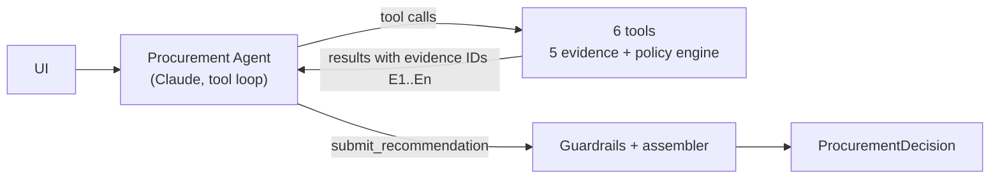
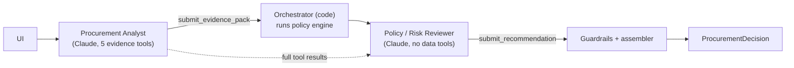

# Architecture and workflow

## Product workflow

```mermaid
flowchart LR
    R["1 · Employee request<br/>(untrusted data)"] --> U["2 · Understand need<br/>(agent)"]
    U --> G
    subgraph G["3 · Gather evidence (tools)"]
        direction TB
        T1["Requester profile<br/>employees.csv"]
        T2["Budget check<br/>department_budgets.csv"]
        T3["Existing software<br/>catalog + purchases"]
        T4["Vendor registry<br/>vendors.csv"]
        T5["Vendor-risk API<br/>external service"]
    end
    G --> P["Deterministic policy engine<br/>thresholds · reviews · freshness ·<br/>conflicts · injection scan"]
    P --> J["4 · Recommend next action<br/>(agent judgment)"]
    J --> GR["Guardrails<br/>(code)"]
    GR --> H["5 · Human review<br/>UI + audit log"]
```

| Concern | Owner | Where |
|---|---|---|
| Interpreting the need, judging overlap (is there a credible gap?), spotting subtle injection or vague justification, writing the recommendation and next step | **AI** | `src/agents/` |
| Required fields, budget arithmetic, approval thresholds, Security / Privacy / Legal triggers, 365-day review validity, cross-source conflicts, regex injection scan, routing priority | **Code** | `src/policy_engine.py`, `src/tools.py` |
| Approving spend, accepting legal terms, exceptions and overrides | **Human** | UI "Human review" panel, `var/audit_log.jsonl` |

## Architecture A: single agent (baseline)

One agent with all six tools runs a manual tool-use loop, usually three model calls: (1) parallel evidence calls, (2) `evaluate_policy_rules`, (3) `submit_recommendation`. The output is a strict-schema tool call.

## Architecture B: staged analyst → reviewer

The analyst gathers evidence and interprets the need without making policy decisions. Code runs the policy engine at the hand-off. The reviewer gets the evidence pack, the full tool results and the engine output. It checks the analyst's claims against the ledger and produces the final recommendation in the same schema as A.

## Tools

| Tool | Deterministic | Input from model | Trusted values resolved by code |
|---|---|---|---|
| `get_requester_profile` | yes | request_id | requester, manager, department head (nearest Director/VP in the reporting line) |
| `check_department_budget` | yes | request_id | cost from the request record, available budget, shortfall |
| `search_existing_software` | yes | request_id, optional query | same product / vendor / category / keyword matches + purchase history |
| `get_vendor_registry_record` | yes | vendor_name | internal registry row (may be stale) |
| `get_vendor_risk_assessment` | external API | vendor_name | `ok` / `not_found` / `unavailable` with retries and a timeout, never raises |
| `evaluate_policy_rules` | yes | request_id | approvals, flags, missing info and route, all with policy section references |

Request-bound tools accept only the request ID, and the session rejects any other ID. The model therefore cannot pass a made-up cost or data class into a check. Every execution is recorded in an evidence ledger with an ID (E1, E2, …). Findings must cite these IDs.

## Hand-off format and stop conditions

- **Agent → code:** `submit_recommendation` (strict JSON schema in `src/agents/schemas.py`): category, summary, cited findings, overlap assessment, injection judgment, insufficient fields, extra flags/approvals, clarifying questions, next step.
- **Analyst → reviewer (B):** `submit_evidence_pack`: need summary, cited findings, overlap assessment, injection judgment, open questions.
- **Stop / escalate conditions** (enforced in code, in priority order): missing required info → *request more information*; tool outage, conflicting sources, unverifiable requester/budget or uncollected evidence → *escalate manual review*; budget shortfall → *Finance budget exception*; any Security / Privacy / Legal trigger → *specialist review*; otherwise → *business approval*. The model may only depart from this order toward more caution, or to *redirect to an existing tool* when it judges the overlap has no credible gap.
- **Loop limits:** at most 8 model turns per agent (2 for the reviewer). If the model never submits, refuses, gets truncated or hits an API error, the run falls back to the deterministic decision and adds the flag `ai_assist_unavailable`.

## Guardrails (`src/assembler.py`), identical for A and B

1. Approvals and flags from the policy engine are authoritative. The model can add to them but cannot remove any.
2. If the model's chosen category breaks the routing rules, code overrides it and logs `category_overridden`.
3. Citations must resolve to ledger IDs. A finding containing a number that does not appear in the cited tool output is replaced with the tool's own summary.
4. Material evidence the model did not cite is still shown, so reviewers always see budget, catalog, registry, risk and policy results.
5. A summary or next step that claims approval, a purchase or waived review is replaced with a template.
6. If the agent skipped a required evidence tool, code runs it ("back-fill") and logs that.
7. `human_review_required` is always `true`.

## Assumptions

- Amounts in requests are already annualised. One-time packages are treated as an annual amount.
- **Department Head** is the nearest Director/VP above the requester. For Sales and Customer Success this is the Go-To-Market director (E007).
- A vendor is **new** if its registry status is `New` or it is not in the registry. Legal's new-vendor rule applies at **≥ $10,000** (inclusive, as written in §7), while the financial tiers use the bands in §4.
- A security assessment is current while `reference_date ≤ review_date + 365 days`. The reference date is read from the policy file (2026-09-30).
- Overlap with a same-product, same-vendor or same-category catalog entry is always **flagged**, because the policy says to surface it. Whether the overlap blocks the request is a model judgment.
- Integration names imply data classes: production/cloud means production access, Git means source code, CRM/helpdesk means customer PII, HRIS/payroll means employee PII. If an integration implies a more sensitive class than the stated one, the request is flagged `data_classification_mismatch` and reviewed at the higher class.
- "No record" at the vendor-risk service means the assessment is missing (Security review). Only transport/5xx failures count as `vendor_risk_unavailable`.
- Budget availability is a snapshot. Other pending requests against the same budget are not reserved.

## What was intentionally not built

- No autonomous actions: nothing writes to budgets, purchasing or vendor systems.
- No more than two agents, and no LLM-based policy evaluation: thresholds belong in code.
- No vector search over the policy. The policy is short and goes into the system prompt in full.
- No authentication or multi-user state. The audit log is a local JSONL file.
